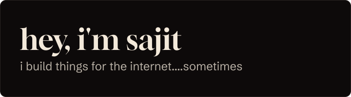

[youtube](https://www.youtube.com/@sajityaps)

## working on

**[sympathy.club](https://sympathy.club)** 
member profiles, the ivory dashboard, and an apparel shop.

**ivory** 
the discord bot behind the site (private repo).

## open source

**[valorant tracker](https://github.com/jynite/valorant-tracker)** 
shows you everyone in your match (rank, peak, k/d, hs%) while you're still in agent select. runs locally off the riot client.

**[the crucible](https://github.com/jynite/The-Crucible-Writing-System-For-Claude)** 
claude skills that take a story from an idea to a first draft. it's [forsonny's project](https://github.com/forsonny/The-Crucible-Writing-System-For-Claude), i just maintain my own fork of it.
